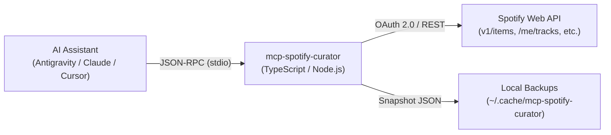

# 🎧 mcp-spotify-curator

[](https://github.com/luizGDpulz/mcp-spotify-curator/actions/workflows/ci.yml)
[](https://opensource.org/licenses/MIT)
[](https://nodejs.org/)
[](https://www.typescriptlang.org/)
[](https://pnpm.io/)
[](https://modelcontextprotocol.io/)

> 🌐 **Language:** **English** | [Português (Brasil)](README.pt-BR.md)

A production-ready **Model Context Protocol (MCP)** server built with **TypeScript** that empowers AI assistants (**Google Antigravity**, Claude Desktop, Cursor, Windsurf, Cline, etc.) to manage, curate, analyze, and automate Spotify playlists with safety and precision.

Runs locally over **`stdio`**, ensuring minimal footprint (0% idle CPU, ~30–50MB RAM), local automatic safety backups before destructive actions, full compatibility with the updated Spotify Web API (`/items`), exponential backoff on Rate Limits (HTTP 429), and total privacy.

---

## 🏗️ Architecture



---

## ✨ Key Features

* **🛡️ Safe by Design:** Automatic local JSON snapshots in `~/.cache/mcp-spotify-curator/backups` before any track overwriting or deletion, with one-command undo via `restore_playlist_backup`.
* **⚡ Modern Spotify API:** Fully migrated to Spotify's updated endpoints (`/items` and `/me/playlists`) to avoid legacy `403 Forbidden` errors.
* **🧹 Smart Deduplication:** Detects exact URI duplicates AND normalized `Title + Primary Artist` pairs (intelligently ignoring remaster suffixes like ` - Remastered 2011`).
* **🎵 Personal Musical Context:** Read-only access to user's Liked Songs, Top Artists/Tracks (short/medium/long term), playback history, and current player state.
* **🔁 Resilient:** Automatic token refreshing in-memory and exponential backoff retry on HTTP 429 Rate Limits.
* **🧩 MCP Native:** Exposes 15 Tools, 4 Resources (`spotify://me/*`), and 3 Curatorial Prompts.

---

## 🛠️ Exposed MCP Tools (15 Tools)

### 📂 Playlist Operations & Atomic Management
| Tool | Input Schema | Description |
| :--- | :--- | :--- |
| `list_user_playlists` | `{ limit?: number }` | List the authenticated user's playlists with IDs, track counts, and URLs. |
| `get_playlist_tracks` | `{ playlist_id: string }` | Fetch sanitized playlist tracks (`uri`, `name`, `artists`, `album`, `release_date`, `duration_ms`, `added_at`). |
| `search_spotify_tracks` | `{ queries: string[] }` | Search catalog by title/artist or advanced query filters (`artist:`, `year:`, `genre:`) and return URIs. |
| `create_playlist` | `{ name: string, description?: string, public?: boolean }` | Create a new empty playlist on the user's account and return its ID and URL. |
| `add_tracks_to_playlist` | `{ playlist_id: string, uris: string[], position?: number }` | Add tracks atomically at the end or specific index without overwriting existing tracks. |
| `remove_tracks_from_playlist` | `{ playlist_id: string, uris: string[] }` | Remove specific tracks by URI with automatic prior backup. |
| `update_playlist_tracks` | `{ playlist_id: string, uris: string[] }` | Replace entire playlist tracks with a new ordered list (with automatic backup and chunked batching). |

### 🪄 Smart Curation, Hygiene & Local Backups
| Tool | Input Schema | Description |
| :--- | :--- | :--- |
| `deduplicate_playlist` | `{ playlist_id: string, dry_run?: boolean, match_by?: "uri" \| "title_artist" }` | Detect and remove duplicate songs or duplicate remastered versions with safety backups. |
| `sort_playlist_by` | `{ playlist_id: string, criteria: "name" \| "artist" \| "album" \| "duration" \| "release_date" \| "added_at", order?: "asc" \| "desc" }` | Sort all playlist tracks by specified criteria and order. |
| `list_playlist_backups` | `{ playlist_id?: string }` | List local snapshot backups saved in `~/.cache/mcp-spotify-curator/backups`. |
| `restore_playlist_backup` | `{ playlist_id: string, backup_id?: string }` | Restore a playlist to an earlier snapshot from a local backup. |

### 🎧 User Musical Context
| Tool | Input Schema | Description |
| :--- | :--- | :--- |
| `get_user_saved_tracks` | `{ limit?: number, offset?: number }` | Retrieve user's Liked Songs library. |
| `get_user_top_items` | `{ type: "artists" \| "tracks", time_range?: "short_term" \| "medium_term" \| "long_term", limit?: number }` | Get user's top artists or tracks across ~4 weeks, ~6 months, or multiple years. |
| `get_recently_played` | `{ limit?: number }` | Fetch user's recent listening history. |
| `get_current_playback` | `{}` | Inspect the song currently playing on the user's Spotify device. |

---

## 🧩 MCP Resources & Prompts

### Resources
* `spotify://me/playlists`: Summary list of current user's playlists.
* `spotify://me/top-artists`: User's top artists (medium term).
* `spotify://me/top-tracks`: User's top tracks (medium term).
* `spotify://playlists/{playlist_id}`: Detailed track listing for any specific playlist.

### Prompts
* `curate-genre-playlist`: Guided workflow to build a thematic or subgenre playlist tailored to the user's taste.
* `smooth-transition-sorter`: Analyzes and reorders an existing playlist into a cohesive DJ-like progression (warmup, climax, cooldown).
* `clean-and-deduplicate`: Audits a playlist for duplicates, remasters, and cleans it up with backup confirmation.

---

## 📋 Prerequisites
* **Node.js** v20+ LTS
* **pnpm** (or npm / yarn)
* A Spotify account (Free or Premium)

---

## 🔑 Spotify Developer Setup (One-Time)

To connect the MCP server securely to your Spotify account via OAuth 2.0:

1. Go to the [Spotify Developer Dashboard](https://developer.spotify.com/dashboard) and sign in.
2. Click **Create app**.
3. Fill in the details:
   * **App name:** `MCP Spotify Curator`
   * **App description:** `Curator server for AI assistants`
   * **Redirect URIs:** Add exactly:
     * `http://127.0.0.1:8888/callback`
     *(Note: Do not use `localhost`; Spotify requires `127.0.0.1` for loopback addresses).*
   * **Which API/SDKs are you planning to use?:** Check **Web API**.
4. Accept the Developer Terms and click **Save**.
5. In your app's **Settings**:
   * Copy the **Client ID**.
   * Click **View client secret** and copy the **Client Secret**.

---

## ⚡ Installation & Setup

### 1. Clone & Install Dependencies

```bash
git clone https://github.com/luizGDpulz/mcp-spotify-curator.git
cd mcp-spotify-curator
pnpm install
```

### 2. Configure Environment

Copy the example environment file:

```bash
cp .env.example .env
```

Open `.env` and fill in your Spotify credentials:

```env
SPOTIFY_CLIENT_ID=your_client_id_here
SPOTIFY_CLIENT_SECRET=your_client_secret_here
```

### 3. Generate Refresh Token

Run the interactive setup script:

```bash
pnpm run auth:setup
```

1. The script will open your browser at `http://127.0.0.1:8888`.
2. Log in and click **Agree**.
3. The script automatically saves the `SPOTIFY_REFRESH_TOKEN` into your `.env` file!

> 💡 The server refreshes the access token silently every hour. You do not need to run this again unless you revoke access.

### 4. Build

```bash
pnpm run build
```

---

## ⚙️ AI Client Configuration

### Google Antigravity (`~/.gemini/config/mcp_config.json`)

```json
{
  "mcpServers": {
    "spotify": {
      "command": "node",
      "args": ["/absolute/path/to/mcp-spotify-curator/dist/index.js"]
    }
  }
}
```

### Claude Desktop (`claude_desktop_config.json`)

* **macOS:** `~/Library/Application Support/Claude/claude_desktop_config.json`
* **Windows:** `%APPDATA%\Claude\claude_desktop_config.json`
* **Linux:** `~/.config/Claude/claude_desktop_config.json`

```json
{
  "mcpServers": {
    "spotify": {
      "command": "node",
      "args": ["/absolute/path/to/mcp-spotify-curator/dist/index.js"]
    }
  }
}
```

### Cursor (`.cursor/mcp.json`)

```json
{
  "mcpServers": {
    "spotify": {
      "command": "node",
      "args": ["/absolute/path/to/mcp-spotify-curator/dist/index.js"]
    }
  }
}
```

### Windsurf (`~/.codeium/windsurf/mcp_config.json`)

```json
{
  "mcpServers": {
    "spotify": {
      "command": "node",
      "args": ["/absolute/path/to/mcp-spotify-curator/dist/index.js"]
    }
  }
}
```

---

## 💬 Example AI Prompts

* *"List all my Spotify playlists with track counts."*
* *"Add 'Resonance - HOME' and 'Midnight City - M83' to the top of my 'Cyberpunk Focus' playlist."*
* *"Analyze my top artists from the last 6 months and create a brand-new playlist inspired by them."*
* *"Check for duplicate tracks or repeated remastered versions in my 'Favorites' playlist and clean them up."*
* *"Reorder my 'Workout' playlist to create a smooth progression from warmup to peak energy and cooldown."*
* *"Undo the last modification to my playlist by restoring the latest local backup snapshot."*

---

## 🛠️ Development Scripts

* `pnpm run build`: Compile TypeScript to `dist/`.
* `pnpm run start`: Launch the MCP stdio server.
* `pnpm run auth:setup`: Run the OAuth 2.0 authorization helper.
* `pnpm run typecheck`: Static TypeScript validation.
* `pnpm test`: Run automated unit and integration tests with Vitest.

---

## 🤝 Contributing

Contributions are very welcome! Please read our [Contributing Guidelines](CONTRIBUTING.md) and check out open issues.

---

## 📄 License

Distributed under the [MIT License](LICENSE).
