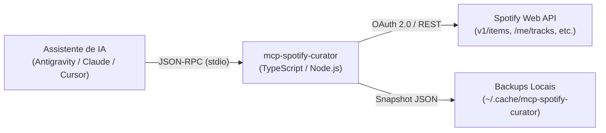

# 🎧 mcp-spotify-curator

[](https://github.com/luizGDpulz/mcp-spotify-curator/actions/workflows/ci.yml)
[](https://opensource.org/licenses/MIT)
[](https://nodejs.org/)
[](https://www.typescriptlang.org/)
[](https://pnpm.io/)
[](https://modelcontextprotocol.io/)

> 🌐 **Language:** [English](README.md) | **Português (Brasil)**

Servidor **MCP (Model Context Protocol)** em TypeScript para curadoria, criação e gerenciamento inteligente de playlists no Spotify diretamente pelo seu assistente de IA (**Antigravity**, Claude Desktop, Cursor, Windsurf, Cline, etc.).

Opera localmente via transporte **`stdio`**, garantindo consumo mínimo de recursos (0% CPU ocioso, ~30–50MB RAM), backups automáticos locais antes de modificações destrutivas, suporte à nova API do Spotify (`/items`), tratamento de Rate Limiting (HTTP 429) e total privacidade.

---

## 🏗️ Arquitetura



---

## 🚀 Ferramentas MCP Disponíveis (15 Tools)

### 📂 Gerenciamento & Operações Atômicas de Playlists
| Ferramenta | Parâmetros | Descrição |
| :--- | :--- | :--- |
| `list_user_playlists` | `{ limit?: number }` | Lista as playlists da conta do usuário para descobrir IDs e detalhes. |
| `get_playlist_tracks` | `{ playlist_id: string }` | Retorna todas as faixas da playlist com URIs, títulos, artistas, álbuns, duração e datas higienizadas. |
| `search_spotify_tracks` | `{ queries: string[] }` | Pesquisa no catálogo musical por termos (ex: `["Bohemian Rhapsody - Queen"]` ou filtros `artist:`, `year:`, `genre:`) e devolve os URIs. |
| `create_playlist` | `{ name: string, description?: string, public?: boolean }` | Cria uma nova playlist no perfil do usuário e devolve seu ID e link direto. |
| `add_tracks_to_playlist` | `{ playlist_id: string, uris: string[], position?: number }` | Adiciona novas faixas atomicamente (no final ou em posição específica) sem sobrescrever a playlist. |
| `remove_tracks_from_playlist` | `{ playlist_id: string, uris: string[] }` | Remove faixas específicas atomicamente com geração automática de backup prévio. |
| `update_playlist_tracks` | `{ playlist_id: string, uris: string[] }` | Substitui todas as faixas da playlist pela nova lista ordenada de URIs (com backup automático e divisão em lotes). |

### 🪄 Curadoria Inteligente, Higienização & Backups Locais
| Ferramenta | Parâmetros | Descrição |
| :--- | :--- | :--- |
| `deduplicate_playlist` | `{ playlist_id: string, dry_run?: boolean, match_by?: "uri" \| "title_artist" }` | Identifica e remove duplicatas exatas ou versões repetidas/remasterizadas da mesma música com backup automático. |
| `sort_playlist_by` | `{ playlist_id: string, criteria: "name" \| "artist" \| "album" \| "duration" \| "release_date" \| "added_at", order?: "asc" \| "desc" }` | Ordena automaticamente todas as faixas da playlist pelo critério escolhido. |
| `list_playlist_backups` | `{ playlist_id?: string }` | Lista snapshots de backup salvos automaticamente em `~/.cache/mcp-spotify-curator/backups`. |
| `restore_playlist_backup` | `{ playlist_id: string, backup_id?: string }` | Restaura uma playlist para um estado anterior a partir de um backup local. |

### 🎧 Contexto Musical Pessoal do Usuário
| Ferramenta | Parâmetros | Descrição |
| :--- | :--- | :--- |
| `get_user_saved_tracks` | `{ limit?: number, offset?: number }` | Obtém as músicas curtidas (*Liked Songs*) da biblioteca do usuário. |
| `get_user_top_items` | `{ type: "artists" \| "tracks", time_range?: "short_term" \| "medium_term" \| "long_term", limit?: number }` | Retorna os artistas ou faixas mais ouvidos pelo usuário em curto (~4 semanas), médio (~6 meses) ou longo prazo. |
| `get_recently_played` | `{ limit?: number }` | Retorna o histórico das últimas faixas reproduzidas pelo usuário. |
| `get_current_playback` | `{}` | Obtém informações sobre a faixa que está tocando neste exato momento no player do Spotify. |

---

## 🧩 MCP Resources & Prompts

### Resources Expostos
* `spotify://me/playlists`: Lista resumida das playlists do usuário autenticado.
* `spotify://me/top-artists`: Artistas mais ouvidos pelo usuário.
* `spotify://me/top-tracks`: Músicas mais ouvidas pelo usuário.
* `spotify://playlists/{playlist_id}`: Faixas detalhadas de uma playlist específica.

### Prompts Pré-definidos
* `curate-genre-playlist`: Cria uma playlist temática alinhada ao gosto musical do usuário.
* `smooth-transition-sorter`: Analisa e reorganiza uma playlist existente em uma progressão fluida de energia.
* `clean-and-deduplicate`: Audita e limpa músicas duplicadas ou versões remasterizadas repetidas com backup seguro.

---

## 📋 Pré-requisitos
* **Node.js** v20+ LTS
* **pnpm** (ou npm / yarn)
* Uma conta no Spotify (Free ou Premium)

---

## 🔑 Passo a Passo: Configuração do Spotify Developer App

Para que o servidor MCP possa acessar sua conta do Spotify de forma segura via OAuth 2.0, você precisa criar um App gratuito no painel do Spotify:

1. Acesse o [Spotify Developer Dashboard](https://developer.spotify.com/dashboard) e faça login com sua conta Spotify.
2. Clique no botão **Create app** (Criar aplicativo).
3. Preencha as informações básicas:
   * **App name:** `MCP Spotify Curator`
   * **App description:** `Curador de playlists via MCP e IA`
   * **Redirect URIs:** Adicione exatamente a URL abaixo e clique em **Add**:
     * `http://127.0.0.1:8888/callback`
     *(Nota: Não utilize `localhost`, pois o Spotify exige `127.0.0.1` para endereços de loopback).*
   * **Which API/SDKs are you planning to use?:** Marque **Web API**.
4. Aceite os termos de serviço do desenvolvedor e clique em **Save**.
5. Na página do seu App recém-criado, clique em **Settings**:
   * Copie o **Client ID**.
   * Clique em **View client secret** e copie o **Client Secret**.

---

## ⚡ Instalação e Autenticação Inicial

### 1. Clonar e Instalar Dependências

```bash
git clone https://github.com/luizGDpulz/mcp-spotify-curator.git
cd mcp-spotify-curator
pnpm install
```

### 2. Configurar o arquivo `.env`

Copie o template de variáveis de ambiente:

```bash
cp .env.example .env
```

Preencha suas chaves do Spotify Developer no `.env`:

```env
SPOTIFY_CLIENT_ID=seu_client_id_aqui
SPOTIFY_CLIENT_SECRET=seu_client_secret_aqui
```

### 3. Gerar o Refresh Token (Execução Única)

Execute o assistente interativo de autenticação:

```bash
pnpm run auth:setup
```

1. O script abrirá o navegador automaticamente em `http://127.0.0.1:8888`.
2. Faça login e clique em **Agree / Autorizar**.
3. O script grava automaticamente o `SPOTIFY_REFRESH_TOKEN` no seu `.env`!

> 💡 O servidor MCP renova o token silenciosamente a cada 1 hora em segundo plano.

### 4. Compilar o Projeto

```bash
pnpm run build
```

---

## ⚙️ Configuração no seu Cliente de IA

### Google Antigravity (`~/.gemini/config/mcp_config.json`)

```json
{
  "mcpServers": {
    "spotify": {
      "command": "node",
      "args": ["/caminho/absoluto/para/mcp-spotify-curator/dist/index.js"]
    }
  }
}
```

### Claude Desktop (`claude_desktop_config.json`)

```json
{
  "mcpServers": {
    "spotify": {
      "command": "node",
      "args": ["/caminho/absoluto/para/mcp-spotify-curator/dist/index.js"]
    }
  }
}
```

### Cursor (`.cursor/mcp.json`)

```json
{
  "mcpServers": {
    "spotify": {
      "command": "node",
      "args": ["/caminho/absoluto/para/mcp-spotify-curator/dist/index.js"]
    }
  }
}
```

### Windsurf (`~/.codeium/windsurf/mcp_config.json`)

```json
{
  "mcpServers": {
    "spotify": {
      "command": "node",
      "args": ["/caminho/absoluto/para/mcp-spotify-curator/dist/index.js"]
    }
  }
}
```

---

## 💬 Exemplos de Uso com a IA

* *"Quais são as playlists que tenho no meu Spotify?"*
* *"Adicione as faixas 'Resonance - HOME' e 'Midnight City - M83' no topo da minha playlist 'Cyberpunk Focus'."*
* *"Analise meus artistas mais ouvidos nos últimos 6 meses e crie uma playlist inédita inspirada neles."*
* *"Verifique se há faixas duplicadas ou versões remasterizadas repetidas na minha playlist 'Favoritas' e limpe com segurança."*
* *"Reorganize minha playlist 'Treino' criando uma transição suave de aquecimento, pico de energia e encerramento."*
* *"Desfaça a última alteração na minha playlist restaurando o backup local mais recente."*

---

## 🛠️ Scripts Disponíveis

* `pnpm run build`: Compila o TypeScript para `dist/`.
* `pnpm run start`: Inicia o servidor MCP stdio.
* `pnpm run auth:setup`: Inicia o assistente de autorização OAuth 2.0.
* `pnpm run typecheck`: Validação estática de tipos TypeScript.
* `pnpm test`: Executa a suíte de testes automatizados e de integração MCP com o test runner nativo do Node.js.

---

## 📄 Licença

Distribuído sob os termos da licença [MIT](LICENSE).
